<a href="https://www.kevin-wang.dev">
  <picture>
    <source media="(max-width: 600px)" srcset="assets/header-mobile.svg" />
    
  </picture>
</a>

<p align="center">
  <a href="https://www.kevin-wang.dev"></a>
  <a href="https://www.linkedin.com/in/kevin-wang-2464a4317/"></a>
  <a href="mailto:kevinw4ng712@gmail.com"></a>
  <a href="https://www.kevin-wang.dev/Kevin-Wang-CV.pdf"></a>
</p>

## About me

I'm **Kevin Wang (Wangxun Wang)**, a fourth-year Bachelor of Engineering (Honours) student specialising in Software Engineering at the **University of Auckland**.

I build full-stack applications, from API routes and databases to responsive interfaces and automated tests. My work includes a clinical prediction platform at the Auckland Bioengineering Institute, a live university club platform, and open-source contributions.

```yaml
based_in: Auckland, New Zealand
education: BE (Honours), Software Engineering · University of Auckland
focus: Full-stack development · Accessible interfaces · Testing
looking_for: Graduate software engineering opportunities in New Zealand
```

## Engineering experience

### Auckland Bioengineering Institute
**Software engineering summer intern · December 2025 – March 2026**

Sole developer of a full-stack web app for an **AI stroke outcome prediction platform**. The app lets clinicians submit MRI scans and assessment data, track prediction jobs, and explore the results.

- Built the application and API routes with **Next.js and TypeScript**, backed by **Prisma, MySQL on AWS RDS, and AWS S3**.
- Integrated a **Niivue 3D brain viewer** with adjustable lesion overlays, PDF reports and segmentation-mask downloads.
- Added mock and simulation modes so the app could be developed and demonstrated without the live database or AI service.
- Wrote **157 unit tests** with Jest and React Testing Library, alongside Playwright end-to-end tests.

[Read the case study →](https://www.kevin-wang.dev/projects/stroke-outcome-prediction) · *Source code is private internship work.*

### Auckland University Strength Society
**Developer, AUSS Member Platform · February 2026 – present**

Part of the student development team building the club's live membership, events and check-in platform.

- Migrated the frontend to **TypeScript and Tailwind CSS v4**.
- Built event RSVP and attendee management, plus cash and bank-transfer payment flows with admin review.
- Contributed input validation, URL security checks, student ID privacy improvements and authentication tests.
- Took work from solutioning through implementation, review and release with the team.

**Stack:** React · TypeScript · Express · Prisma · PostgreSQL · Zod · Stripe · Railway

[Case study →](https://www.kevin-wang.dev/projects/auss-member-platform) · [Live platform](https://auss-backend-production.up.railway.app/) · [Team repository](https://github.com/ProjectAuss2026/Myauss)

## Selected projects

| Project | What I built or contributed | Technologies |
| :--- | :--- | :--- |
| **[Plateful](https://github.com/UOA-DCML/se310-plateful)**<br>Open-source contributor | Responsive restaurant discovery UI, frontend test setup, navigation and accessibility improvements. **6 merged pull requests** and **5 peer PR reviews**.<br>[Case study](https://www.kevin-wang.dev/projects/plateful) · [Live demo](https://uoa-dcml.github.io/se310-plateful/) | React · Spring Boot · MongoDB · Vitest · React Testing Library |
| **[Guess Who's the Thief](https://github.com/kwan244/Guess-Who-Game)**<br>Three-person team project | AI-powered suspect dialogue, game logic, clue progression, puzzles and media playback for a detective game.<br>[Case study](https://www.kevin-wang.dev/projects/guess-whos-the-thief) | Java · JavaFX · Maven · OpenAI API |
| **[Personal portfolio](https://github.com/kwan244/personal-website)**<br>Personal project | A drawn desk scene with interactive project notes, light and dark themes, accessible navigation, case studies and generated social previews.<br>[Visit the site](https://www.kevin-wang.dev) | Next.js · TypeScript · Tailwind CSS · Playwright · axe |
| **[Rock Paper Scissors](https://github.com/kwan244/RockPaperScissorsWebsite)**<br>Solo learning project | A browser game with three difficulty modes, an opponent that adapts to move history, and scores that survive a refresh.<br>[Case study](https://www.kevin-wang.dev/projects/rock-paper-scissors) · [Play](https://kwan244.github.io/RockPaperScissorsWebsite/) | JavaScript · HTML · CSS · localStorage |

## Tech stack

Tools I've used across internship work, team projects and my own applications.

**Languages**


**Frontend**


**Backend & APIs**


**Databases & cloud**


**Testing & accessibility**


**Delivery & tools**


## GitHub at a glance

A snapshot of my GitHub activity. The language chart reflects code in public commits.

<p align="center">
  <picture>
    <source media="(prefers-color-scheme: dark)" srcset="https://github-profile-summary-cards.vercel.app/api/cards/profile-details?username=kwan244&name=Kevin%20Wang&theme=github_dark&title_color=6ee7b7&text_color=9fb8ad&bg_color=0a0d0c&border_color=24302b&icon_color=6ee7b7&chart_color=6ee7b7" />
    
  </picture>
  <picture>
    <source media="(prefers-color-scheme: dark)" srcset="https://github-profile-summary-cards.vercel.app/api/cards/stats?username=kwan244&theme=github_dark&title_color=6ee7b7&text_color=9fb8ad&bg_color=0a0d0c&border_color=24302b&icon_color=6ee7b7&chart_color=6ee7b7" />
    
  </picture>
  <picture>
    <source media="(prefers-color-scheme: dark)" srcset="https://github-profile-summary-cards.vercel.app/api/cards/most-commit-language?username=kwan244&theme=github_dark&title_color=6ee7b7&text_color=9fb8ad&bg_color=0a0d0c&border_color=24302b&icon_color=6ee7b7" />
    
  </picture>
</p>

[Explore my repositories →](https://github.com/kwan244?tab=repositories) · [View contributions →](https://github.com/kwan244)

## Good things begin with a conversation.

I'm looking for a **graduate full-stack software engineering role in New Zealand**, and I'm happy to talk about projects, collaboration or engineering opportunities.

**[Explore my work](https://www.kevin-wang.dev)** · **[Connect on LinkedIn](https://www.linkedin.com/in/kevin-wang-2464a4317/)** · **[Email me](mailto:kevinw4ng712@gmail.com)**
